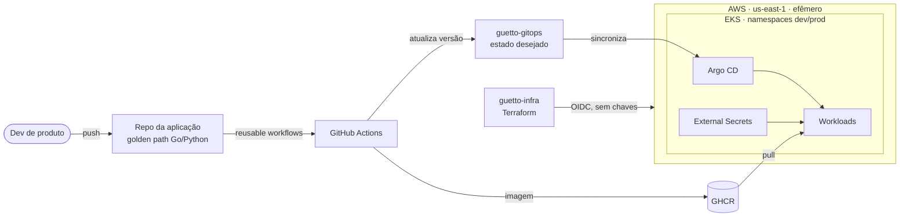

# Guetto Platform

**Uma Internal Developer Platform de escopo controlado, construída para aprender Platform Engineering na prática —
com cada decisão documentada.**

> *"Descreva sua aplicação em um arquivo, faça push, e ela roda com deploy, rollback, telemetria e guardrails
> padronizados — sem escrever YAML de Kubernetes."*
>
> Esse é o contrato que a plataforma quer oferecer a um dev de produto (Go ou Python) que não deveria precisar
> dominar EKS, IAM ou Prometheus para ter um serviço saudável no ar.

## Como o projeto é conduzido

- **Thinnest Viable Platform:** nenhum componente entra sem um ADR que aponte o problema que ele resolve.
  Nada de portal, CLI própria ou multi-cluster "porque impressiona"
  ([ADR-0001](https://github.com/guetto-plataform/.github/blob/main/docs/adr/0001-plataforma-como-produto-e-escopo-do-mvp.md)).
- **Decisões registradas:** cada escolha relevante tem contexto, alternativas, trade-offs e fontes —
  [índice de ADRs](https://github.com/guetto-plataform/.github/blob/main/docs/adr/README.md).
- **Ambiente efêmero e real:** AWS de verdade (EKS, IAM, rede privada com NAT), que sobe e desce por comando.
  Nada que cobre por hora fica ligado fora das sessões de estudo
  ([ADR-0002](https://github.com/guetto-plataform/.github/blob/main/docs/adr/0002-aws-com-ambiente-efemero.md)).

## Arquitetura-alvo

Terraform vai até "cluster + Argo CD"; tudo dentro do cluster depois disso é GitOps.

## Estado atual

| Fase | Objetivo | Status |
|---|---|---|
| 0 | Definição: problema, persona, métricas, ADRs iniciais | ✅ Concluída |
| 1 | AWS efêmera: bootstrap, rede, EKS por Terraform; `up`/`down` | 🚧 Em andamento — bootstrap concluído |
| 2 | GitOps: Argo CD, ESO, Load Balancer Controller | ⏳ |
| 3 | Golden path: chart `guetto-app`, templates Go/Python, reusable workflows | ⏳ |
| 4 | Observabilidade: OpenTelemetry, SLO com burn-rate, runbooks | ⏳ |
| 5 | Guardrails: políticas de admissão, RBAC, NetworkPolicy | ⏳ |
| 6 | Release seguro: Argo Rollouts ou Kargo | ⏳ |

[Roadmap completo e critérios de conclusão](https://github.com/guetto-plataform/.github/blob/main/docs/roadmap.md).

## O que já está de pé

- **Bootstrap por conta AWS** ([guetto-infra/00-bootstrap](https://github.com/guetto-plataform/guetto-infra/tree/main/00-bootstrap)):
  bucket de state no namespace regional da conta, com lock nativo do S3; o state da própria camada é migrado para
  dentro do bucket que ela cria.
- **CI sem credenciais permanentes:** GitHub Actions assume uma role via OIDC; a trust policy exige o `sub` com IDs
  imutáveis do repositório **e** um GitHub Environment que só aceita o branch `main`
  ([ADR-0012](https://github.com/guetto-plataform/.github/blob/main/docs/adr/0012-acesso-da-ci-a-aws-via-oidc.md),
  incluindo os riscos aceitos).
- **Proteções de custo:** budget de custo bruto (créditos não mascaram o gasto) e reaper diário que derruba o
  ambiente ([ADR-0014](https://github.com/guetto-plataform/.github/blob/main/docs/adr/0014-reaper-horario-fixo.md)).
- **Conta AWS intercambiável:** nenhum account ID, ARN ou bucket fixo no código; trocar de conta é um comando
  ([ADR-0011](https://github.com/guetto-plataform/.github/blob/main/docs/adr/0011-bootstrap-local-state-migrado-e-scripts-bash.md)).

## Repositórios

Cada repositório é uma fronteira de responsabilidade e só é criado na fase em que é necessário
([ADR-0009](https://github.com/guetto-plataform/.github/blob/main/docs/adr/0009-multirepo-por-fronteira-de-responsabilidade.md)).

| Repositório | Responsabilidade | Status |
|---|---|---|
| [`.github`](https://github.com/guetto-plataform/.github) | Este perfil, ADRs, arquitetura, roadmap | Ativo |
| [`guetto-infra`](https://github.com/guetto-plataform/guetto-infra) | Terraform em camadas: bootstrap, rede, EKS | Ativo |
| `guetto-gitops` | Estado desejado do cluster (add-ons + apps) | Fase 2 |
| `guetto-charts` | Chart `guetto-app` publicado como OCI | Fase 3 |
| `guetto-ci` | Reusable workflows versionados | Fase 3 |
| `template-*` / `sample-*` | Golden paths e apps de exemplo | Fase 3 |

Módulos Terraform vêm de uma biblioteca externa versionada,
[vitorfprado/terraform-aws-modules](https://github.com/vitorfprado/terraform-aws-modules), consumida por tag
([ADR-0010](https://github.com/guetto-plataform/.github/blob/main/docs/adr/0010-reutilizar-biblioteca-de-modulos-terraform.md)).

## Stack

AWS (EKS, IAM, VPC) · Terraform · GitHub Actions · Argo CD · External Secrets Operator · Helm · GHCR ·
OpenTelemetry · Go · Python · Bash

---

Projeto de [@vitorfprado](https://github.com/vitorfprado). Documentação em português; termos técnicos consagrados
em inglês.
